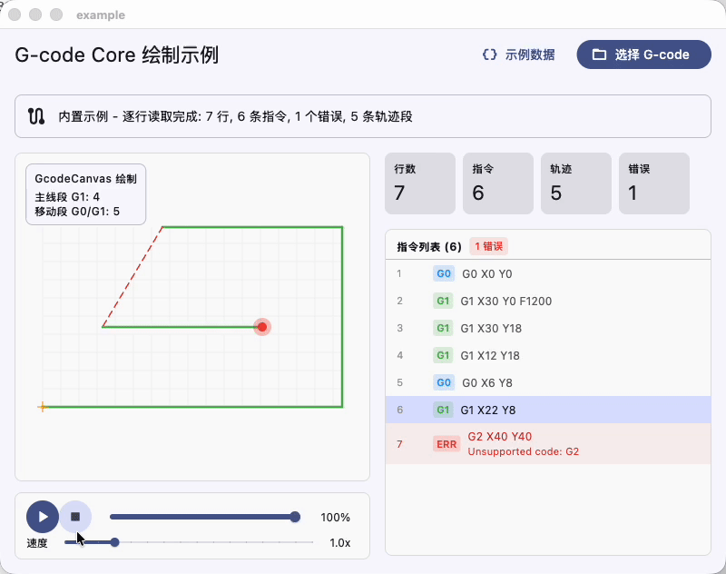

# gcode_core

Development uses Flutter 3.50.0 stable (Dart 3.14.0), pinned in `.fvmrc` and CI.



G-code parsing, streaming toolpath construction, playback UI, and Flutter GPU
visualization for Flutter applications.

## Install

Install version 0.2.1 from pub.dev:

```yaml
dependencies:
  gcode_core: ^0.2.1
```

Flutter 3.47.2 or newer is required. The package bundles its compiled shader
asset; consumers do not need to copy shader files manually.

## Platform support

| Platform | Status | Requirements |
| --- | --- | --- |
| macOS | Supported | macOS 12+, Impeller and Flutter GPU enabled |
| Android | Supported | API 29+, ARM64, Impeller and Flutter GPU enabled |
| iOS | Not supported | No validated host contract in 0.2.1 |
| Windows | Not supported | Flutter GPU renderer is not admitted in 0.2.1 |
| Linux | Not supported | No validated host contract in 0.2.1 |
| Web | Not supported | The renderer and file reader use native-only APIs |

Unsupported platforms do not imply that parsing concepts are platform-specific;
the published package as a whole includes a GPU-only Flutter renderer and is
released only against the hosts listed as supported.

### Host configuration

For a macOS host, use Flutter 3.47.2 and add these keys to the top-level dict in
`macos/Runner/Info.plist`:

```xml
<key>FLTEnableImpeller</key>
<true/>
<key>FLTEnableFlutterGPU</key>
<true/>
```

The macOS deployment target must be at least 12.0. On Android, use a minimum SDK
of 29, build for `arm64-v8a`, and keep Impeller enabled. The example project is
the reference host configuration for both platforms. Add the following metadata
inside the Android host application element:

```xml
<meta-data
    android:name="io.flutter.embedding.android.EnableFlutterGPU"
    android:value="true" />
```

Example Xcode/CocoaPods
workarounds do not propagate into consumer apps and should only be adopted if
the same build issue occurs.

## Scope

- Read G-code from strings or files line by line.
- Parse G0/G1 commands with X/Y/F parameters.
- Collect parse errors with line metadata.
- Build incremental or batch toolpath segments.
- Render paths, grid, origin and moving markers with Flutter GPU.
- Render command timelines and playback controls for Flutter frontends.

This package does not open system file pickers or own app-level playback state.

## Bounded loading previews

Use `GcodeReadlineOptions(previewLimit: 2000,
minimumSnapshotInterval: Duration(milliseconds: 100))` for bounded intermediate
snapshots. `previewLimit` is a **source-line cutoff**: commands, segments and
bounds all describe that prefix. `previewLineLimit` identifies the frozen
preview. Within one load, later snapshots reuse the frozen command, error and
segment lists. Background loading transfers those lists once and sends progress
updates until a terminal snapshot arrives.
`commandCount`, `errorCount` and `segmentCount` report full processed totals,
which may exceed the preview list lengths. Ready and failed snapshots contain
all processed data. Existing callers retain cumulative snapshots by default.

Timing diagnostics use the same entry-count cap for intermediate snapshots.
`GcodeTimeEstimate.issueCount` preserves the total and `issuesTruncated` identifies
partial diagnostic lists. An empty truncated list never makes an incomplete
estimate complete. `snapshotWithIssueLimit` exposes this behavior to timing-only
consumers. Background loaders acknowledge each consumed snapshot before the
worker sends another; cancellation closes the port and stops the worker.

`GcodeCanvas.stats` optionally accepts a stable `GcodeRenderStats` instance. Its
geometry-build, vertex-upload, frame-composition, surface and resource-set
counters describe CPU submissions and explicit clearing, **not GPU execution
time or native memory reclamation**. Progress-only playback should leave geometry
build and vertex-upload counters unchanged. `onReady` is emitted for each
segment-list version after successful frame composition.

## macOS GPU drawing

Flutter 3.47.2 or newer is required. `GcodeCanvas` is GPU-only: G0 dashes,
G1 lines, background paths, playback, grid, origin, tool head and glow are all
rendered by GPU shaders. There is no Canvas backend or automatic fallback.
Flutter only composites the resulting image and displays ordinary UI widgets.
The renderer has no Canvas fallback. Unsupported GPU initialization is surfaced
as an error so applications can provide an explicit unavailable state.

```dart
GcodeCanvas(
  segments: snapshot.segments,
  bounds: snapshot.bounds,
  progress: progress,
)
```

Treat the segment list as immutable; replace it when path data changes. Viewport
and line-width changes rebuild geometry; playback only updates GPU uniforms.
The host must enable Impeller and Flutter GPU. The macOS example contains the
required Info.plist settings. Shader sources and their compiled SDK bundle live
under `shaders/`; `python3 example/tool/build_gpu_shaders.py` regenerates them.
The macOS compatibility runner automatically runs shader compilation:

```sh
python3 example/tool/macos_run.py --mode release
python3 example/tool/macos_run.py --mode profile --target lib/gpu_validation.dart
```

The validation entry point writes GPU scene images at different progress values, runs 20
recreation/resize cycles, and measures 10,000 parsed G0/G1 segments. Its log
reports the output directory. This does not benchmark file loading or snapshots.

### API migration

Remove the former `backend` argument and `GcodeCanvasBackend` references.
`GcodeStyle` uses immutable `GcodeStroke(color, width)` values (`rapidMove`,
`rapidBackground`, `linearMove`, `linearBackground`, `grid`, `origin`) and color
fields (`toolHeadColor`, `toolHeadGlowColor`, `originDotColor`), replacing Paint
objects. Unsupported GPU initialization is reported as an error, never a
fallback renderer.

## Validation

```bash
flutter test
(cd example && flutter test)
```

CI keeps separate quality, Android build, macOS build, and platform-contract
jobs. Android is deliberately constrained to API 29+ and `arm64-v8a`. Native
acceptance evidence remains platform-specific; adding a new host requires its
own build, runtime, rendering, lifecycle, and performance evidence. See
`AGENTS.md` for the admission contract.

## Example

Run the Flutter example app:

```bash
cd example
flutter run -d macos
# or an API 29+ ARM64 Android device
flutter run -d <android-device-id>
```

IDE runs use `example/lib/main.dart` with the macOS device. The example's
Xcode and CocoaPods configurations enable the scoped compiler-probe workaround
automatically, including Debug builds. The Flutter build phase also removes
non-macOS deployment-target environment variables that conflict with clang's
Debug framework build. No global Xcode or Flutter SDK changes are required.

The example demonstrates local file selection, streaming parse snapshots,
`GcodeCanvas` drawing, `CommandTimeline`, and `PlaybackControls`.

Minimal usage:

```dart
import 'package:gcode_core/gcode_core.dart';

Future<void> main() async {
  const source = '''
G0 X0 Y0
G1 X10 Y0 F1200
G1 X10 Y10
''';

  final pipeline = GcodeReadlinePipeline();

  await for (final snapshot
      in pipeline.load(const StringGcodeLineReader(source))) {
    if (snapshot.stage == GcodeLoadStage.ready) {
      print(snapshot.commands.length);
      print(snapshot.segments.length);
      print(snapshot.errors.length);
    }
  }
}
```

Default pipeline loads keep their builder state independent. A supplied
`toolpathBuilder` instance is exclusive to one active direct load; overlapping
use throws `StateError`. String and file readers accept CR, LF and CRLF.
Background loads report invalid timing options through the stream, and
cancelling their subscription releases the worker. The example cancels an
active load before replacing it or disposing its controller.

`GcodeCanvas.onReady` reports the first successfully presented GPU frame.
`onError` reports initialization or later drawing failures. Readiness is not a
frame-rate or memory-stability guarantee.

## License

MIT. See [LICENSE](LICENSE).

## Estimated machining time

Use the public package entrypoint. For timing-only consumers, import
`package:gcode_core/gcode_time.dart`; it does not import Flutter widgets or GPU
libraries. All timing APIs are also exported by `package:gcode_core/gcode_core.dart`.
Neither entrypoint requires native plugin initialization for timing.

| Public API | Input | Result |
| --- | --- | --- |
| `estimateGcodeTime` | Complete source string | Synchronous `GcodeTimeEstimate` |
| `estimateGcodeFileTime` | Local UTF-8 file path or file URI | `Future<GcodeTimeEstimate>` |
| `estimateGcodeStreamTime` | `Stream<String>`, one source line per event | `Future<GcodeTimeEstimate>` |
| `GcodeTimeEstimator.append` / `snapshot` | Incremental source lines | Immutable timing snapshots |

```dart
import 'package:gcode_core/gcode_time.dart' as gcode;

Future<void> estimateJob(String filePath) async {
  const options = gcode.GcodeTimeOptions(pulsePerMm: 1000);
  final fromText = gcode.estimateGcodeTime(
    'G0 F600 X10 Y0\nG25 X20 Y0 T1000', options: options,
  );
  print(fromText.estimatedSeconds); // 2.00145 seconds, including G0 travel

  final fromFile = await gcode.estimateGcodeFileTime(filePath, options: options);
  if (fromFile.isComplete) {
    print(fromFile.estimatedSeconds); // Seconds under the demo model
  } else {
    for (final issue in fromFile.issues) {
      print('Line ${issue.lineNumber}: ${issue.message}');
    }
  }

  final fromStream = await gcode.estimateGcodeStreamTime(
    Stream.fromIterable(['G0 F600 X10', 'G1 F600 X20']), options: options,
  );
  print(fromStream.estimatedSeconds); // 2 seconds
}
```

All APIs accept the same `GcodeTimeOptions`: `pulsePerMm=1000`,
`initialXMode=true`, optional `rapidFeedRate` and `markFeedRate` in mm/min.
Invalid options throw `ArgumentError` (through the Future for async APIs).
File/encoding and upstream stream errors propagate through the Future; they do
not return a successful partial estimate. Async APIs consume one subscription
and release it on completion or failure. Streams must contain one line per event
and finish before a result can return; upstream cancellation remains with the
caller. Timing-only imports do not expand the package's declared platform support.

`GcodeTimeEstimator.append` supports incremental estimation. All three readline
entrypoints accumulate timing during the existing pass and expose `timeEstimate`
on snapshots. `snapshot.estimatedSeconds` is available only after a successful,
complete load; the example displays this value. Set `GcodeReadlineOptions.timeOptions`
to supply actual axis calibration and optional initial G0/G1 feed rates.

The estimator follows the supplied BSL demo model with separate modal G0/G1
speeds (F in mm/min), modal coordinate lines, G25 movement plus T exposure and
jump settling, M202 L/H delays in microseconds and N distance in millimetres,
G102 N pulses/F pulses per second, and G103 T microseconds. Defaults are
1000 pulses/mm, initial X mode, 200/700 microseconds and 20 mm jump distance.
G102 subtracts the offset from axis position, retains axis mode, and changes
motion mode to G0; G103 adds the offset and selects axis/motion mode from O/L.
G102 O1 homing is excluded, as in the demo. G4 T is milliseconds.

For this package, coordinates accept integers and decimals; G90/G91 are
supported. Trailing waits and stationary G103 durations count even without a
visible segment. Parenthesized and trailing semicolon comments are ignored;
repeated parameters use their last value, matching the renderer parser.
M2/M3/M5/M200/M201 are recognized but
add no time; arbitrary M commands are reported as unsupported. Missing speeds,
missing exposure, invalid parameters or unsupported motion produce line issues
and a null `estimatedSeconds`; `knownSeconds` is a diagnostic subtotal, not a
complete duration or guaranteed lower bound. Successful timing can coexist with
renderer parse errors: rendering still supports only G0/G1 and G90/G91.

This is an active machining estimate, excluding upload, preparation, pauses,
homing, acceleration and other hardware delays. No empirical correction factors
or device accuracy claims are introduced. Playback remains a visual preview;
its progress is not driven by the estimated physical duration.

## Mixed vector and bitmap playback

Build one immutable scene per project revision and pass it to the canvas on
each playback tick. Supply operations in machining order and use the same
machine coordinate system for vector endpoints and bitmap pixel steps.

```dart
final preview = MachiningPreview([
  VectorPreviewOperation(outline),
  BitmapPreviewOperation(exposureBitmap),
  VectorPreviewOperation(finishingPath),
]);

// In the playback widget:
GcodeCanvas.mixed(preview: preview, progress: progress);
```

By default each vector segment and each bitmap row contributes one playback
unit. To allocate progress by estimated duration, supply a positive finite
`weight` in the same time unit for every operation. Within an operation
progress advances uniformly by segment or scan row. The full vector background
stays visible. Foregrounds composite in operation order on one GPU surface.
A scene retains its vector buffer and each displayed raster texture during
playback and seeking. Resizing rebuilds screen-space path geometry.

For time-based preview playback, create a `PreviewTimeline` once per scene or
speed configuration and pass elapsed preview time divided by its
`totalSeconds` to `GcodeCanvas.timed`.

```dart
final timeline = PreviewTimeline(preview, speeds: PreviewSpeeds());
GcodeCanvas.timed(
  timeline: timeline,
  progress: timeline.totalSeconds == 0 ? 1 : elapsedSeconds / timeline.totalSeconds,
);
```

The defaults are 12 machine units/second for G1, 48 for G0, and 120 rows/second
for exposure bitmaps. Blank rows and hidden travel consume preview time.
The host can apply a playback multiplier to elapsed time. A timeline with
zero total seconds can be displayed directly at progress 1. The timed canvas
derives durations from the speed configuration. The existing mixed canvas
continues to use operation weights.
